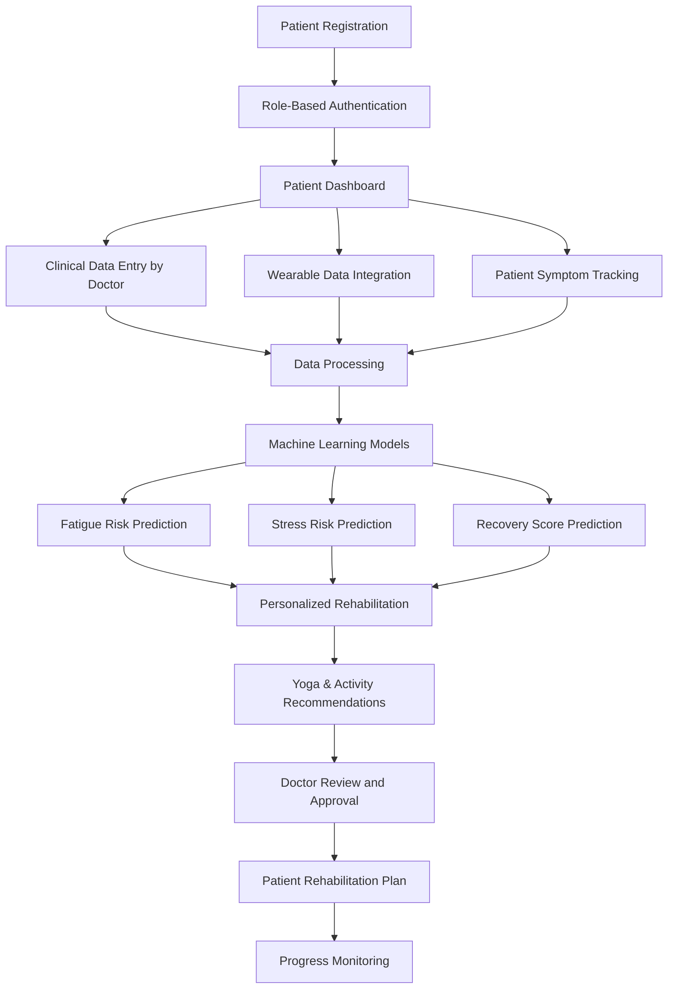

# 🌿 RehabAI
### AI-Powered Cancer Rehabilitation & Personalized Yoga Platform

RehabAI is an AI-enabled healthcare platform designed to support cancer rehabilitation through personalized yoga recommendations, clinical data analysis and wearable-based health monitoring.

The platform combines doctor-entered clinical information, patient-reported symptoms and wearable measurements to help monitor fatigue, stress and recovery, while providing personalized rehabilitation guidance.

## 🎯 Key Features

### 1. Cancer Rehabilitation
- Patient clinical profile and medical history.
- Fatigue and stress monitoring.
- Recovery score assessment.
- Daily symptom and activity tracking.
- Historical recovery analytics.

### 2. Personalized Yoga Rehabilitation
- Categorized yoga pose library.
- Gentle yoga and chair yoga.
- Breathing exercises and meditation.
- Guided yoga sessions.
- Personalized rehabilitation plans.
- Doctor-reviewed yoga recommendations.

### 3. Wearable Integration
Designed to support integrations with:
- Fitbit
- Garmin
- Apple Health
- Google Health Connect

Available measurements may include heart rate, HRV, steps, physical activity and sleep data, depending on device capabilities and authorization.

### 4. AI-Based Health Analysis
Existing machine learning research models support three prediction tasks:

- Fatigue Risk Prediction
- Stress/Anxiety Risk Prediction
- Recovery Score Prediction

### 5. Role-Based Access
- **Patient:** Monitor recovery, access yoga plans and track progress.
- **Doctor:** Manage clinical records, review AI assessments and approve rehabilitation plans.
- **Admin:** Manage users, roles, integrations and platform settings.

## 🔄 System Workflow



## 🛠️ Technology Stack

| Component | Technologies |
|---|---|
| Frontend | Next.js, React, TypeScript |
| Styling | Tailwind CSS, shadcn/ui |
| Backend | Next.js API Routes, Python FastAPI |
| Database | Supabase, PostgreSQL |
| Authentication | Supabase Auth |
| Machine Learning | Python, Pandas, NumPy, Scikit-learn |
| Model Storage | Joblib |
| Visualization | Recharts |
| Deployment | Vercel, Supabase and compatible Python hosting |

## 📂 Project Structure

```text
RehabAI/
│
├── app/                 # Application pages and API routes
├── components/          # Reusable UI components
├── lib/                 # Database and authentication utilities
├── public/               # Static assets
├── supabase/
│   └── migrations/      # Database migrations
│
├── ml-service/
│   ├── main.py          # FastAPI application
│   ├── models/          # Trained ML model artifacts
│   └── requirements.txt
│
├── .env.example
├── package.json
└── README.md
```

*The structure may vary depending on the current implementation.*

## ⚙️ Getting Started

### Prerequisites
- Node.js
- npm or pnpm
- Python 3.10+
- Supabase project
- Required machine learning model artifacts

### Installation

**1. Clone the repository**

```bash
git clone <your-repository-url>
cd RehabAI
```

**2. Install dependencies**

```bash
npm install
```

**3. Configure environment variables**

Create a `.env.local` file using `.env.example`.

```env
NEXT_PUBLIC_SUPABASE_URL=your_supabase_url
NEXT_PUBLIC_SUPABASE_ANON_KEY=your_supabase_anon_key
OWNER_EMAIL=your_owner_email
ML_SERVICE_URL=your_fastapi_service_url
```

Use the appropriate current Supabase publishable key if your project uses the newer key format.

**4. Start the frontend**

```bash
npm run dev
```

Open `http://localhost:3000` in your browser.

**5. Start the ML service**

```bash
cd ml-service
pip install -r requirements.txt
uvicorn main:app --reload
```

Configure the actual model artifact paths and environment variables before enabling predictions.

## 🔐 Security & Privacy

- Role-based access control.
- Supabase Row Level Security.
- Secure authentication.
- Patient consent for wearable integrations.
- Protected clinical information.
- Controlled doctor-patient access.
- Audit logging.

## ⚕️ Medical Disclaimer

RehabAI is a research-oriented rehabilitation decision-support platform. Its predictions and recommendations are not medical diagnoses or substitutes for professional medical advice. Rehabilitation and yoga activities should be reviewed by qualified healthcare professionals.

Research models trained using synthetic datasets must not be treated as clinically validated.

## 🚀 Project Vision

To make cancer rehabilitation more accessible through AI-supported recovery monitoring and personalized yoga guidance, helping patients stay connected with their rehabilitation journey from home.

---

**RehabAI | Supporting Recovery Through AI & Yoga**
